# A.R.M.S. | Hardware Design

## 영상 조회수 합계 약 530만 회

| **제작·시연 영상 · 조회수 161만 회** | **TJB NEWS 보도 · 조회수 369만 회** |
|:---:|:---:|
|  |  |
| **[▶ 대학생이 만든 요격드론](https://youtu.be/Cgwz7hQSDEw)** | **[▶ 대학생 동아리가 만든 ‘첨단 무기’](https://youtu.be/K94Nv2nxkzc)** |
| INAIR 인에어 | TJB NEWS |

*2026.11.19 YouTube 공개 화면 기준. 조회수 합계는 두 영상의 표시 수치를 합산한 값입니다.*

## 1. ARMS 소개

A.R.M.S. (Anti-drone Reusable Modular System)는 드론을 이용하여 침입 드론을 공중에서 요격하고, 임무가 끝난 뒤 다시 회수해 사용할 수 있도록 만든 재사용 요격 드론이다. 발사기에 설치된 요격 드론을 발사하면 탑재된 카메라와 영상 인식을 통해 표적을 탐지하고 추적한다. 이후 표적에 근접해 요격하고, 임무를 마친 기체는 다시 조종자에게 회수할 수 있도록 구성했다. 또한, 임무에 따라 필요한 장비를 교체할 수 있도록 모듈형 구조를 적용했다. 즉, 특정 임무만 수행하는 하나의 무기가 아니라 필요한 장비를 교체해 여러 역할에 활용할 수 있는 범용 플랫폼을 만드는 것이 목표다.

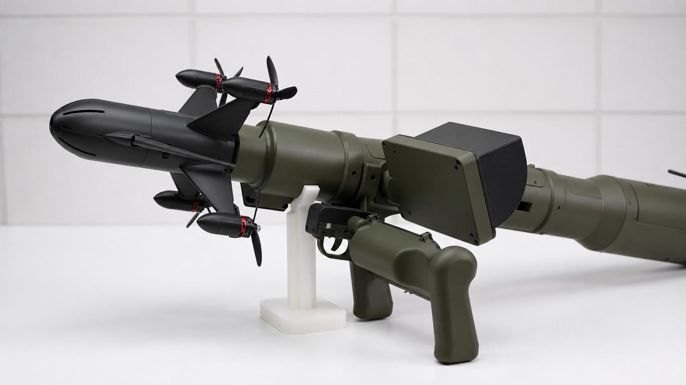

## 2. 개발 배경과 필요성

러시아-우크라이나 전쟁은 드론이 현대전의 주력 살상 무기로 올라섰음을 전 세계에 증명했다. 러시아군 사상자의 70~80%가 드론 타격에서 발생한 것으로 추정되며, 2025년 한 해에만 약 41만 5천 명이 드론으로 사살 및 중상을 입었다. 값싼 소모품이었던 소형 드론이 이제는 전장을 지배하는 단일 최대 위협이 된 것이다.
반면 소형 드론은 작고, 느리고, 낮게 날며, 대량으로 운용된다. 레이더에 잘 잡히지 않는 데다, 설령 탐지하더라도 수억 원짜리 미사일로 수십만 원짜리 드론을 상대하는 것은 경제적으로도 지는 싸움이다. 고속 단일 표적용 방패로 저속 대량 표적을 막으려는 이 구조적 불일치가 현재 방공의 가장 큰 빈틈이며, A.R.M.S.는 바로 이 빈틈을 저비용으로 메우기 위해 출발했다. 
A.R.M.S.는 고가의 장비 없이 소형 드론 위협에 실시간 대응하는 저비용 요격 플랫폼을 만드는 것이 출발점이다. 여기에 회수 및 재사용 설계를 더해 운용 비용까지 낮추면, 예산이 넉넉하지 않은 조직도 도입할 수 있다.

## 3. 하드웨어 구성

하드웨어는 공중 비행체와 지상 발사기로 구분된다. 영상 처리와 유도 명령 생성처럼 연산량이 큰 기능은 지상의 Jetson에 배치하고, 비행체에는 영상 전송과 비행에 필요한 장비만 탑재하였다.

이와 같은 분산 구조를 통해 비행체의 무게와 연산 부담을 줄이고, 발사기에서 알고리즘과 사용자 인터페이스를 통합적으로 관리할 수 있도록 하였다.

## 4. 기체 설계

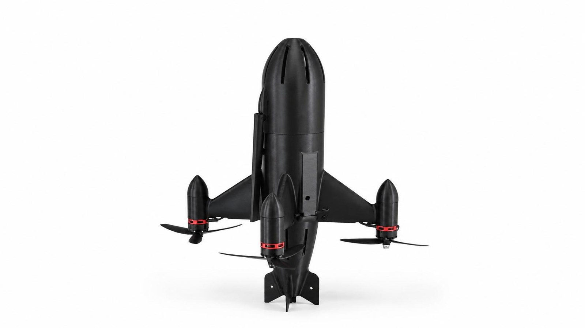

*요격 비행체 정면 형상*

### 내부 하우징

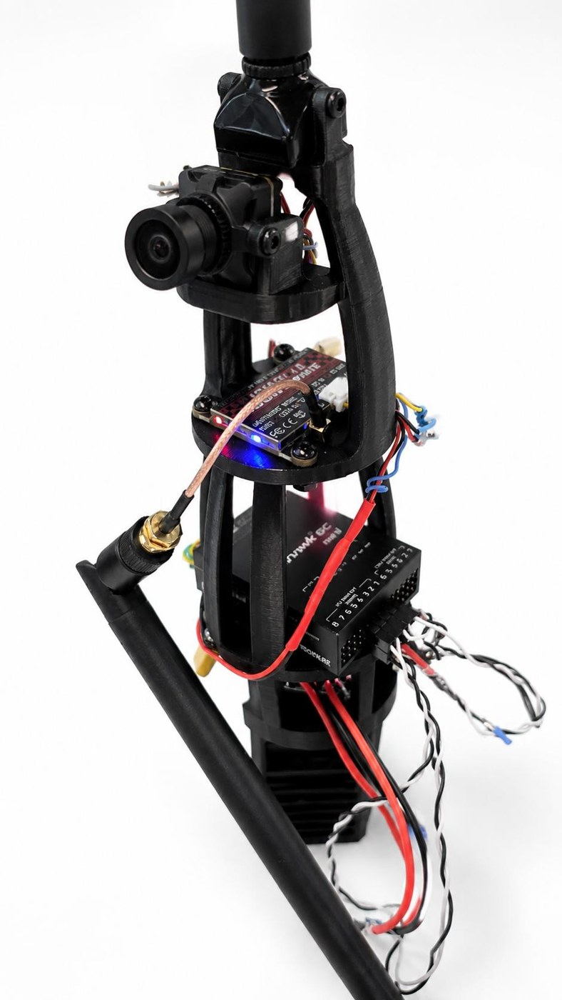

*비행체 내부 하우징과 전장 배치*

내부 공간의 활용성을 극대화하고 안정성을 확보하기 위해 수직 다층 형태로 설계하였다. 내부 배선 꼬임을 방지하고 케이블 길이를 최적화하며, 비행 시 전달되는 진동과 외부 충격으로부터 내부 전장을 보호하는 역할을 한다. 또한 각 층을 삽입형 하우징으로 구성해 전장 모듈을 슬롯에 꽂기만 하면 즉시 사용할 수 있도록 하였다. 별도의 재배선이나 공구 작업 없이 모듈 단위 교체가 가능하므로, 야전 운용 환경에서 정비 시간을 크게 줄이고 임무에 따라 필요한 모듈만 바꿔 끼우는 모듈형 운용에 적합하다.

층별로 기능을 분리한 적층 구조는 각 단이 독립된 단순 형상을 갖도록 하여, 3D 프린팅뿐 아니라 사출 성형 등 양산 공정으로의 전환이 용이하다. 동일 규격의 층을 반복 생산해 조립하는 방식이므로 단품 가공 부담이 적고, 손상된 층만 교체하거나 특정 층만 재설계해도 전체 구조를 유지할 수 있어 유지보수성과 대량생산성을 함께 확보한다.

### 전면부 나사산 구조

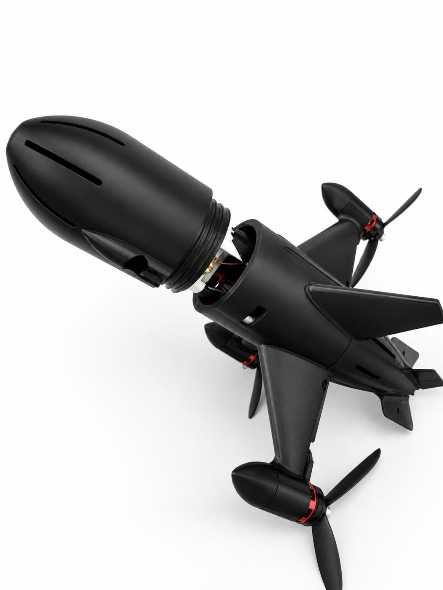

*교체형 전방부 나사산 체결 구조*

전면부 노즈는 나사산 체결 방식을 적용하여 별도의 도구 없이 손쉽게 회전시켜 분리할 수 있도록 설계하였다. 노즈를 분리하면 배터리 장착 슬롯에 바로 접근이 가능하다. 전체 프레임이나 외부 하우징을 해체하지 않고도 배터리를 즉시 교체하거나 충전 단자에 케이블을 연결할 수 있어 운용 편의성을 확보하였다.

### 전면 공기 흡입구 구조

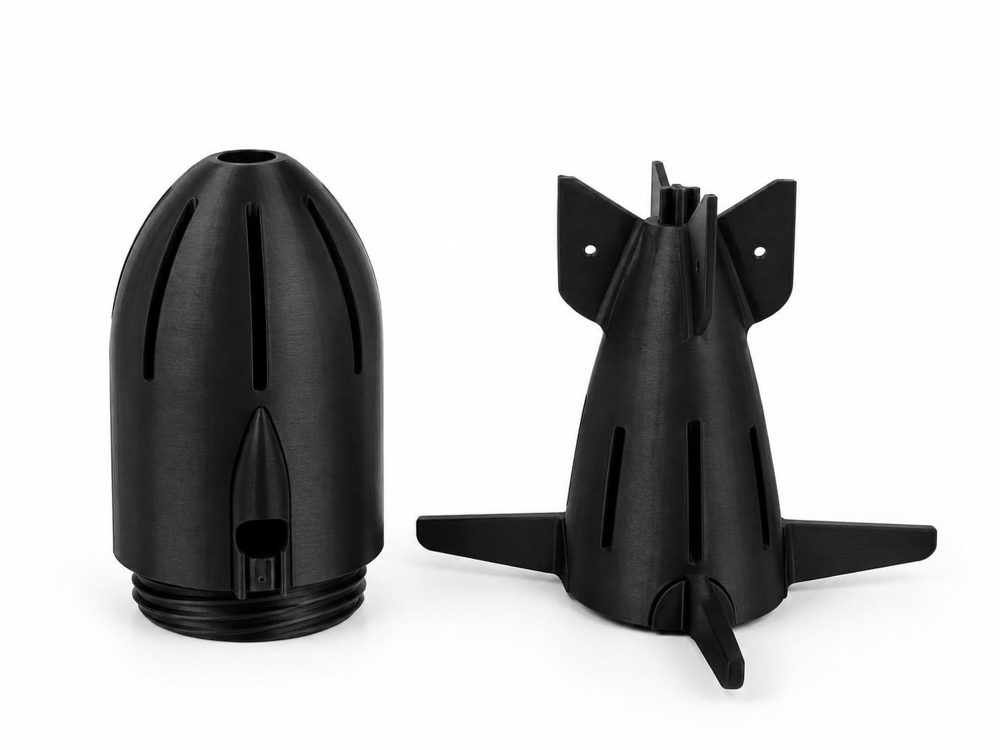

*전방 공기 흡입구와 내부 냉각 유로*

VTX의 지속적인 작동에 의한 발열 문제를 해결하기 위해 전면부 중앙에 공기 흡입구 역할을 하는 별도의 구멍을 설계하였다. 전진 비행 시 이 구멍을 통해 외부 공기가 내부로 직접 유입되며, VTX 방열판 부근을 통과하여 후방으로 배출되는 냉각 유동 경로를 형성하였다. 이를 통해 팬을 추가하지 않고도 효과적으로 온도를 제어하여 발열로 인한 출력 저하 및 신호 끊김 현상을 방지하였다.

### 기체 전장 구성

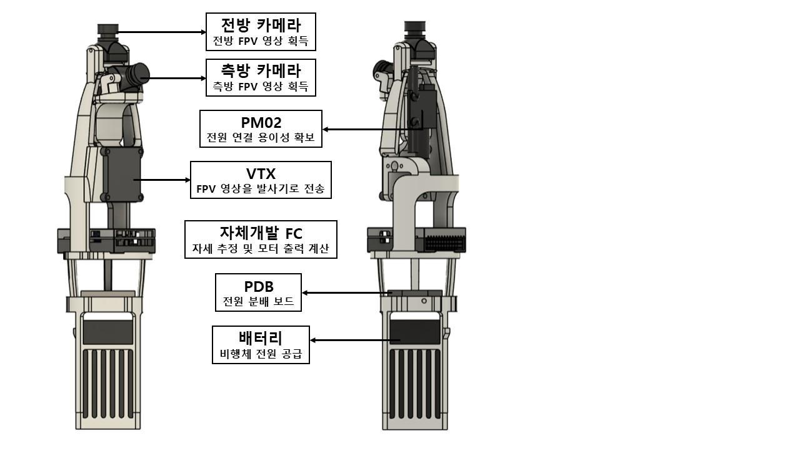

*비행체 주요 전장 구성*

*esc와 모터는 따로 기입하지 않았음*

## 5. 응력 해석 및 CFD 유동 해석

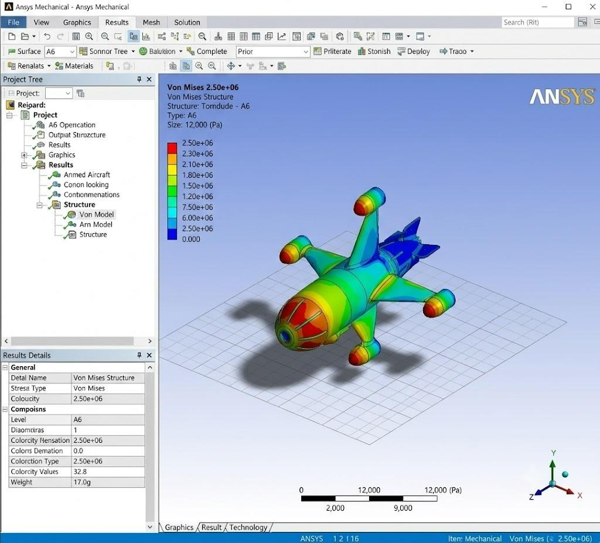

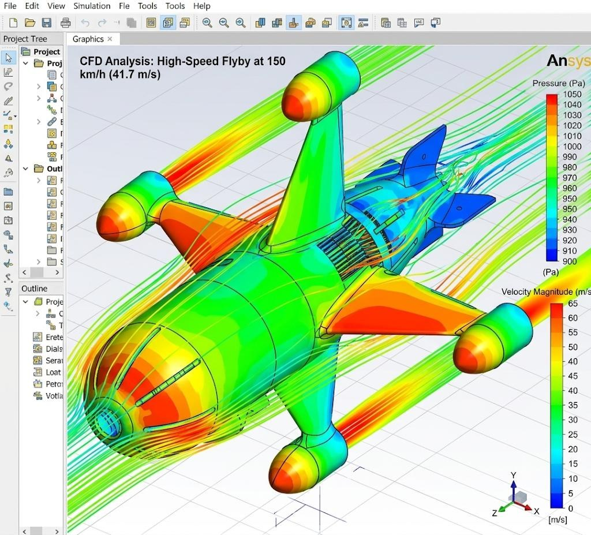

*기체 구조 및 CFD 유동 해석 결과*

### 구조 및 응력 해석

총 전장 중량 1.1 kg 조건을 반영하여 해석을 진행한 결과, 전방 돔 부위와 4개 암에 최대 2.5 MPa의 응력이 집중되는 것을 확인하였다. 반면 중앙 동체 및 후방 구역은 0.5 MPa 이하의 매우 낮은 응력 상태를 나타내어 하중이 기체 전반으로 안정적으로 분산됨을 입증하였다. 산출된 최대 등가 응력은 사용 재료의 항복 강도 대비 매우 낮은 수준으로, 비행 중 발생하는 하중 조건에서도 영구 변형이나 파손 위험 없이 충분한 구조적 안전율을 확보했음을 확인하였다.

### 유동 해석(CFD)

운용 속도 100~150 km/h 조건에서 해석을 진행한 결과, 최고 속도인 150 km/h 비행 시 상단 돔과 각 암에 1,080 Pa의 최대 정압이 형성되었다. 반면 암 후방 유동 박리 구역에는 -420 Pa의 음압이 발생하여 100 km/h에서 14.5 N, 150 km/h에서 32.6 N의 항력이 각각 산출되었다. 이때 항력 계수는 0.38로 설계 목표치인 0.45 이하를 충족하였다. 암 후면 모서리를 3 mm 조정할 경우 와류 구역이 감소하여 150 km/h 조건에서 항력이 약 2 N 감소하는 개선 효과를 확인하였다.

## 6. 발사기 설계

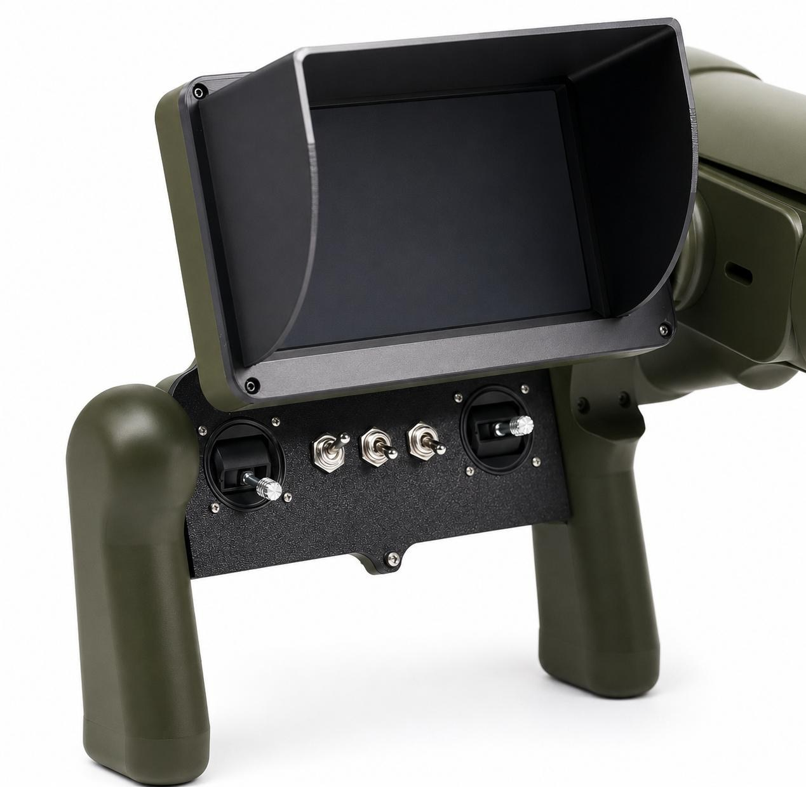

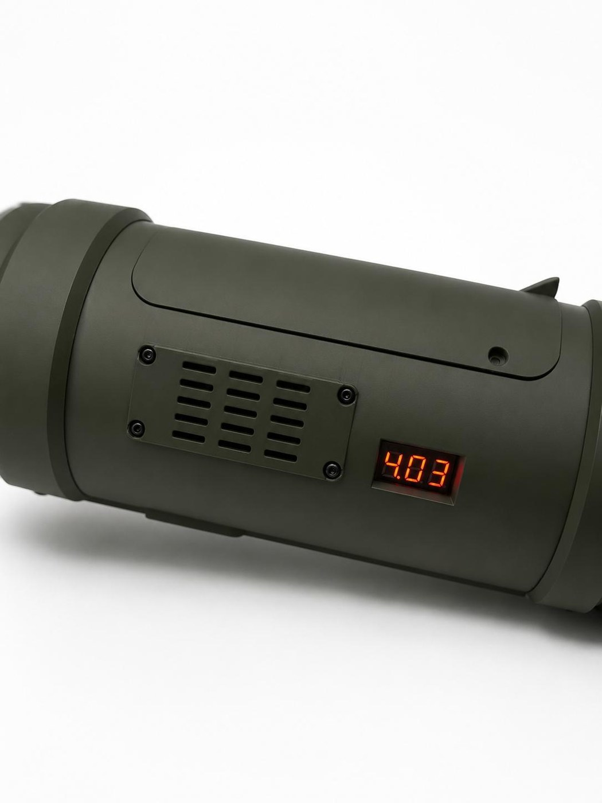

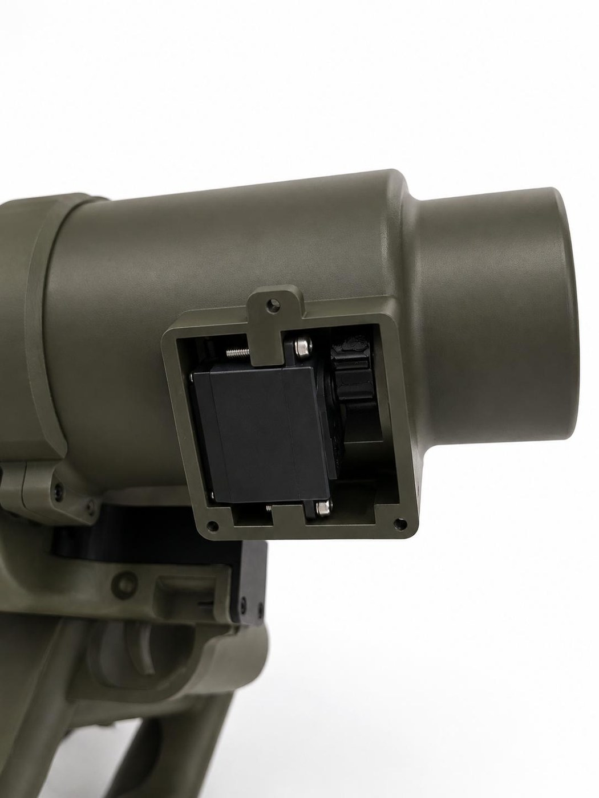

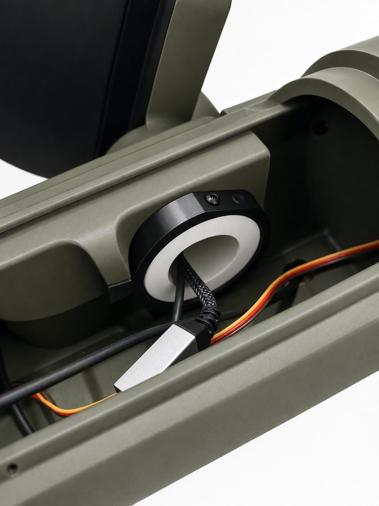

*발사기의 주요 기구 설계*

### 디스플레이부

햇빛 환경에서의 빛 반사를 막기 위해 디스플레이에 검정색 차광 가리개를 장착하였다. 또한 운용자마다 시야각이 다른 점을 고려하여, 원통형 스프링을 디스플레이 회전부에 적용해 디스플레이 각도를 자유롭게 조절할 수 있도록 설계하였다.

### 발사 메커니즘

드론 발사는 서보모터 기반 클램프 개방 방식으로 작동하며, 전방부 서보모터 장착부를 전용 케이스로 보호해 외부 충격과 이물질로부터 안전하게 격리하였다.

### 조종부

조종기는 실제 M16 소총의 손잡이 형태를 벤치마킹하여 설계하였다. 장시간 파지 시에도 피로감이 적고 직관적인 조작이 가능하도록 하였으며, 내부에 스틱과 스위치의 신호를 수신하는 ESP32 보드가 여유 있게 수납될 수 있도록 충분한 공간을 확보하였다.

### 전장 설계

내부 전장에 접근할 일이 잦은 점을 고려하여 탈부착식 뚜껑 구조를 적용하였다. RC832 채널 변경을 위한 접근 구멍, 스피커 음향 출력을 위한 타공, LiPo 알람 전압 확인용 구멍을 각각 적절한 위치에 뚫었다. Jetson Orin Nano의 발열 관리를 위해 상단에 통풍구를 설계하여 열 배출 경로를 확보하였다. 또한 안테나 탈착이 용이하도록 전용 구멍을 마련하였다.

## 7. 발사기 전장 구성

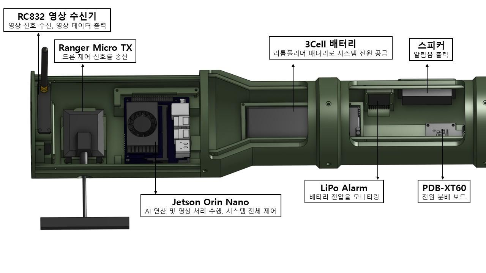

*발사기 내부 전장 구성*

## 8. 제작·실물 사진

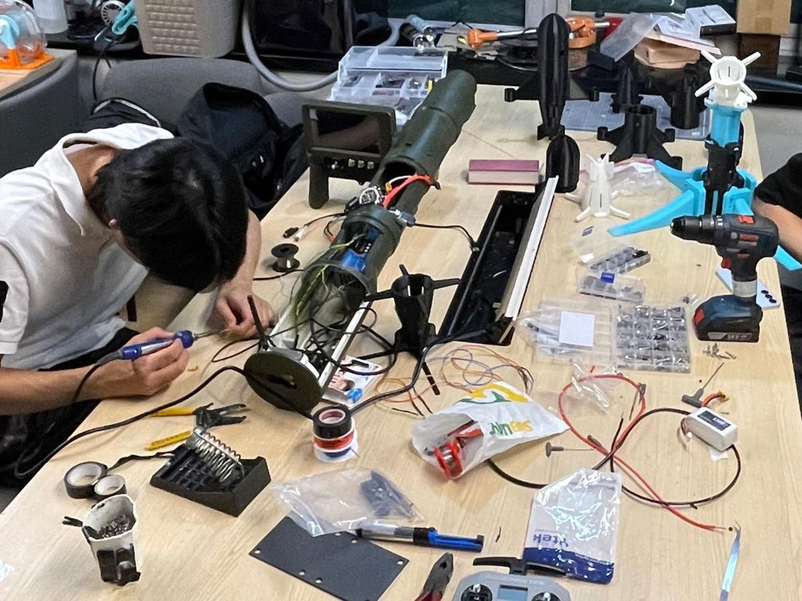

*보고서 실기체 전장 조립 과정.*

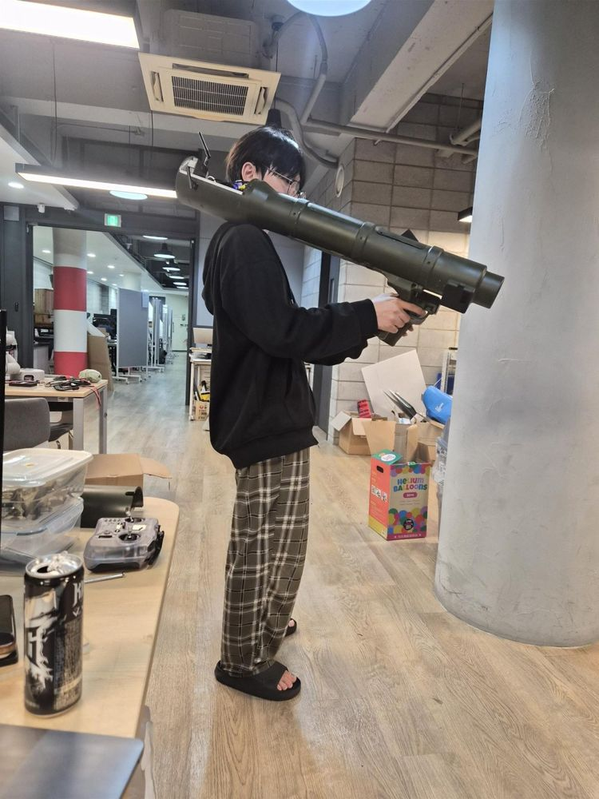

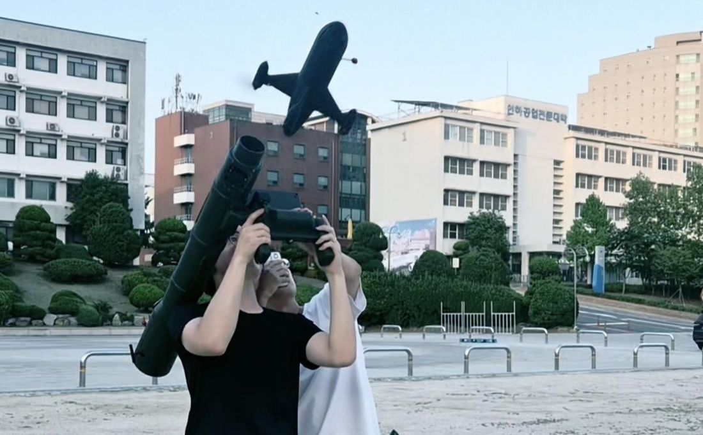

*보고서에 수록된 실물 시제품 사진.*

## 9. HW 설계 파일

- [기체 STEP 파일](HW/drone_step/)
- [발사기 STEP 파일](HW/launcher_step/)
- [디스플레이 STEP 파일](HW/launcher/)
- [전장 설계 자료](HW/ElectricalSystemDesign.md)
- [부품·기자재 목록](HW/INAIR_%EC%9E%AC%EC%82%B0%ED%91%9C.xlsx)

---

본문·사진 출처: 「항공드론 종합설계 경진대회_INAIR_최종결과 보고서」.
